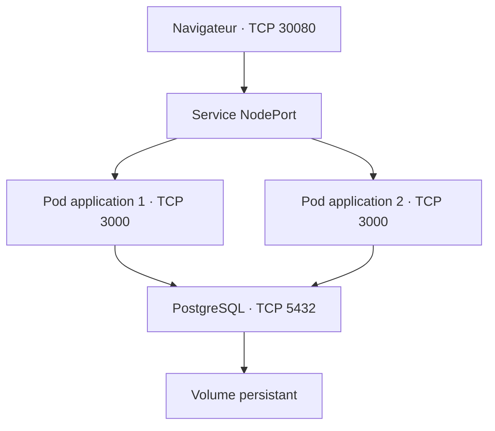

# TaskFlow — Gestion de tâches sur Kubernetes

Application web de gestion de tâches construite avec Node.js et Express,
utilisant PostgreSQL pour partager les données entre deux Pods Kubernetes.

Le projet comprend une interface responsive, une image Docker publiée
sur Docker Hub et un déploiement k3s sur AWS EC2.

**Auteur :** Mootez Kallel

[Code source](https://github.com/M-Kallel/node.js.app) ·
[Docker Hub](https://hub.docker.com/r/mootezkallel/nodejs-app)

## Fonctionnalités

- Création, suppression et suivi des tâches.
- Filtres : toutes, à faire et terminées.
- Compteurs de progression.
- Validation des titres : texte de 1 à 200 caractères.
- Stockage PostgreSQL partagé entre les réplicas.
- Indicateur de connexion à la base.
- Affichage du Pod ayant répondu.
- Journaux structurés et identifiant de requête.
- Arrêt propre du serveur et des connexions PostgreSQL.

## Technologies

| Composant | Technologie |
|---|---|
| Backend | Node.js, Express |
| Base de données | PostgreSQL 17 |
| Client PostgreSQL | node-postgres (`pg`) |
| Interface | HTML, CSS, JavaScript |
| Conteneurisation | Docker |
| Registre | Docker Hub |
| Orchestration | Kubernetes, k3s |
| Infrastructure | AWS EC2, Ubuntu |
| Versionnement | Git, GitHub |

## Architecture



Les deux Pods applicatifs utilisent la même base PostgreSQL.
La base est exposée uniquement à l'intérieur du cluster.

## Organisation du projet

| Chemin | Rôle |
|---|---|
| `server.js` | Démarrage HTTP et arrêt propre |
| `src/app.js` | Routes, validation et gestion des erreurs |
| `src/database.js` | Pool de connexions PostgreSQL |
| `sql/001_tasks.sql` | Initialisation de la table des tâches |
| `public/index.html` | Interface TaskFlow |
| `package.json` | Configuration et dépendances |
| `package-lock.json` | Verrouillage des dépendances |
| `Dockerfile` | Construction de l'image |
| `.dockerignore` | Exclusions du contexte Docker |
| `.gitignore` | Exclusions Git |
| `k8s/deployment.yaml` | Deux réplicas de l'application |
| `k8s/service.yaml` | Accès NodePort sur 30080 |
| `k8s/postgres.yaml` | Service, StatefulSet et stockage PostgreSQL |

## API

| Méthode | Route | Description |
|---|---|---|
| GET | `/` | Interface web |
| GET | `/health` | État du processus Node.js |
| GET | `/ready` | Vérification de l'accès à la table PostgreSQL |
| GET | `/api/info` | Version, environnement et identité du Pod |
| GET | `/api/tasks` | Liste des tâches |
| POST | `/api/tasks` | Création d'une tâche |
| PATCH | `/api/tasks/:id` | Modification de son état |
| DELETE | `/api/tasks/:id` | Suppression d'une tâche |

### Création

```bash
curl -i -X POST http://localhost:3000/api/tasks \
  -H 'Content-Type: application/json' \
  -d '{"title":"Préparer une démonstration"}'
```

### Modification de l'état

```bash
curl -i -X PATCH http://localhost:3000/api/tasks/1 \
  -H 'Content-Type: application/json' \
  -d '{"done":true}'
```

Un PATCH sans propriété `done` inverse l'état actuel.

### Réponses principales

| Code | Signification |
|---|---|
| 200 | Lecture ou modification réussie |
| 201 | Tâche créée |
| 204 | Tâche supprimée |
| 400 | Données invalides |
| 404 | Ressource introuvable |
| 413 | Corps de requête trop volumineux |
| 500 | Erreur interne |
| 503 | Base indisponible sur `/ready` |

## Configuration

| Variable | Description |
|---|---|
| `PORT` | Port HTTP, 3000 par défaut |
| `NODE_ENV` | Environnement, `production` dans Kubernetes |
| `PGHOST` | Hôte PostgreSQL |
| `PGPORT` | Port PostgreSQL |
| `PGDATABASE` | Nom de la base |
| `PGUSER` | Utilisateur PostgreSQL |
| `PGPASSWORD` | Mot de passe PostgreSQL |

Les mots de passe ne doivent pas être enregistrés dans Git.

## Installation locale

Prérequis : Node.js, npm et une base PostgreSQL accessible.

```bash
git clone https://github.com/M-Kallel/node.js.app.git
cd node.js.app
npm ci

export PGHOST=127.0.0.1
export PGPORT=5432
export PGDATABASE=todo
export PGUSER=todo

read -rsp "Mot de passe PostgreSQL : " PGPASSWORD
echo
export PGPASSWORD
```

Créer préalablement la base et l'utilisateur, puis initialiser la table
avec le client PostgreSQL `psql` :

```bash
psql -v ON_ERROR_STOP=1 -f sql/001_tasks.sql
npm start
```

Ouvrir http://localhost:3000.

## Image Docker

Image applicative publiée :

```text
mootezkallel/nodejs-app:2.1
```

### Construction et publication

Depuis la racine du projet :

```bash
sudo docker build -t mootezkallel/nodejs-app:2.1 .
sudo docker login -u mootezkallel
sudo docker push mootezkallel/nodejs-app:2.1
```

### Récupération

```bash
sudo docker pull mootezkallel/nodejs-app:2.1
```

Cette version nécessite les variables de connexion PostgreSQL.
Un simple lancement de l'image sans configuration de base ne suffit
pas à rendre l'API des tâches disponible.

## Installation sur Kubernetes

### Prérequis

- Cluster k3s opérationnel et nœud `Ready`.
- StorageClass `local-path` disponible.
- Accès réseau à Docker Hub.
- Port TCP 30080 autorisé depuis l'IP publique du client.
- Git, OpenSSL et accès administrateur au cluster.

Les commandes ci-dessous utilisent le namespace `default`.

### 1. Créer le Secret PostgreSQL

À exécuter une seule fois lors de l'installation initiale :

```bash
(
  set -e
  umask 077
  secret_file=$(mktemp)
  trap 'rm -f "$secret_file"' EXIT

  openssl rand -hex 32 | tr -d '\n' > "$secret_file"

  sudo k3s kubectl create secret generic todo-db \
    --from-literal=POSTGRES_DB=todo \
    --from-literal=POSTGRES_USER=todo \
    --from-file=POSTGRES_PASSWORD="$secret_file"
)
```

Si `todo-db` existe déjà, ne pas le recréer ni générer un nouveau
mot de passe pour une base déjà initialisée. Une rotation nécessite
aussi de modifier le mot de passe dans PostgreSQL.

Le Secret est créé directement dans le cluster et n'est pas stocké
dans ce dépôt. Il faut le conserver de façon sécurisée pour une restauration.

### 2. Déployer PostgreSQL

```bash
sudo k3s kubectl apply -f k8s/postgres.yaml

sudo k3s kubectl rollout status \
  statefulset/postgres --timeout=180s
```

### 3. Initialiser le schéma

Après disponibilité de PostgreSQL :

```bash
sudo k3s kubectl exec -i postgres-0 -- \
  psql -U todo -d todo -v ON_ERROR_STOP=1 < sql/001_tasks.sql
```

### 4. Déployer l'application et son Service

```bash
sudo k3s kubectl apply -f k8s/deployment.yaml
sudo k3s kubectl apply -f k8s/service.yaml

sudo k3s kubectl rollout status \
  deployment/nodejs-app --timeout=180s
```

### 5. Vérifier

```bash
sudo k3s kubectl get deployment nodejs-app
sudo k3s kubectl get pods -o wide
sudo k3s kubectl get service nodejs-app-service
sudo k3s kubectl get pvc
```

Résultats attendus :

- Application : deux Pods prêts et Deployment `2/2`.
- PostgreSQL : Pod `postgres-0` prêt.
- Volume PostgreSQL : PVC `Bound`.
- Service applicatif : `80:30080/TCP`.

## Accès extérieur

```text
http://<IP_PUBLIQUE_EC2>:30080/
http://<IP_PUBLIQUE_EC2>:30080/ready
```

Utiliser l'adresse publique actuelle de l'instance EC2.
La source autorisée dans le Security Group doit correspondre à l'IP
publique actuelle du client.

## Santé et disponibilité

- `/health` vérifie que le serveur HTTP répond.
- `/ready` vérifie l'accès à la table `tasks`.
- La sonde liveness utilise `/health`.
- La sonde readiness utilise `/ready`.

Un Pod qui n'est pas prêt est retiré des destinations prêtes du Service.

## Vérifier les données partagées

Après création d'une tâche, interroger chaque Pod :

```bash
for pod in $(sudo k3s kubectl get pods \
  -l app=nodejs-app \
  -o jsonpath='{.items[*].metadata.name}'); do

  echo "$pod"

  sudo k3s kubectl exec "$pod" -- node -e \
    "fetch('http://localhost:3000/api/tasks').then(r=>r.text()).then(console.log)"
done
```

Les deux réponses doivent contenir les mêmes tâches
en l'absence de modifications simultanées.

## Vérifier le remplacement d'un Pod

Observer les changements dans un terminal :

```bash
sudo k3s kubectl get pods -l app=nodejs-app -w
```

Dans un autre terminal :

```bash
POD_TO_DELETE=$(sudo k3s kubectl get pods \
  -l app=nodejs-app \
  -o jsonpath='{.items[0].metadata.name}')

sudo k3s kubectl delete pod "$POD_TO_DELETE"

sudo k3s kubectl rollout status \
  deployment/nodejs-app --timeout=180s
```

Kubernetes crée un nouveau Pod pour maintenir deux réplicas.
Les tâches restent dans PostgreSQL.

## Publier une nouvelle version

1. Modifier et tester le code.
2. Construire l'image avec un nouveau tag.
3. Publier cette image sur Docker Hub.
4. Modifier le champ `image` dans `k8s/deployment.yaml`.
5. Appliquer le fichier et vérifier le déploiement.
6. Enregistrer les fichiers dans Git.

```bash
sudo k3s kubectl apply -f k8s/deployment.yaml

sudo k3s kubectl rollout status \
  deployment/nodejs-app --timeout=180s
```

Un push ou une fusion Git ne déclenche pas automatiquement Kubernetes :
aucune pipeline de déploiement automatique n'est configurée dans ce projet.

Une modification de documentation ne nécessite pas de reconstruire l'image.

## Dépannage

### Journaux applicatifs

```bash
sudo k3s kubectl logs -l app=nodejs-app \
  --all-containers=true --prefix=true --tail=100
```

### Journaux PostgreSQL

```bash
sudo k3s kubectl logs postgres-0 --tail=100
```

### Événements et stockage

```bash
sudo k3s kubectl get events --sort-by=.metadata.creationTimestamp
sudo k3s kubectl get pvc
```

### Destinations du Service

```bash
sudo k3s kubectl get endpointslices \
  -l kubernetes.io/service-name=nodejs-app-service
```

Si l'application répond dans la VM mais pas dans le navigateur,
vérifier l'IP publique EC2, le port 30080 et l'IP source autorisée dans AWS.

## Limites actuelles

- Les visiteurs partagent la même liste : aucune authentification.
- Le cluster possède un seul nœud.
- PostgreSQL possède un seul réplica.
- Le volume `local-path` dépend du stockage de la VM.
- Un volume persistant ne remplace pas une sauvegarde.
- L'accès du laboratoire utilise HTTP.

Les prochaines évolutions sont l'authentification, HTTPS,
des sauvegardes testées et une pipeline CI/CD.
