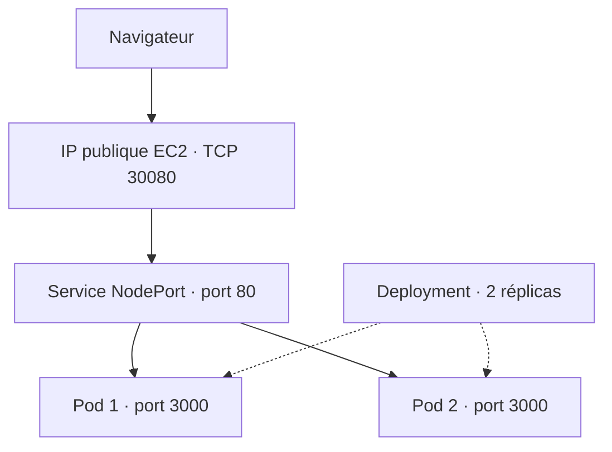

# To-Do App — Déploiement Cloud avec Docker et Kubernetes

Application de gestion de tâches développée avec Node.js et Express,
conteneurisée avec Docker et déployée sur un cluster Kubernetes k3s
hébergé sur AWS EC2.

**Auteur :** Mootez Kallel

[Code source](https://github.com/M-Kallel/node.js.app) ·
[Image Docker Hub](https://hub.docker.com/r/mootezkallel/nodejs-app)

## Présentation

Ce projet illustre les principales étapes de déploiement d'une application :

- Développement d'une interface web et d'une API.
- Gestion du code source avec Git et GitHub.
- Construction et exécution d'une image Docker.
- Publication de l'image sur Docker Hub.
- Déploiement de deux réplicas sur Kubernetes.
- Exposition de l'application avec un Service NodePort.
- Vérification du remplacement automatique d'un Pod supprimé.

## Fonctionnalités

- Ajouter une tâche.
- Marquer une tâche comme terminée.
- Supprimer une tâche.
- Consulter l'identité de l'application et du Pod.
- Vérifier l'état du processus avec la route `/health`.

## Technologies

| Composant | Technologie |
|---|---|
| Serveur HTTP et API | Node.js, Express |
| Interface | HTML, CSS, JavaScript |
| Gestion de versions | Git, GitHub |
| Conteneurisation | Docker |
| Registre d'images | Docker Hub |
| Orchestration | Kubernetes, k3s |
| Infrastructure | AWS EC2, Ubuntu |

## Architecture



Les deux Pods sont hébergés sur la même instance EC2.
Le Deployment maintient le nombre de réplicas demandé.

## Organisation du projet

| Fichier ou dossier | Rôle |
|---|---|
| `server.js` | Serveur Express et routes de l'API |
| `public/` | Interface web et fichiers statiques |
| `package.json` | Dépendances et commandes npm |
| `Dockerfile` | Construction de l'image Docker |
| `.dockerignore` | Exclusions du contexte de construction |
| `.gitignore` | Exclusions du dépôt Git |
| `k8s/deployment.yaml` | Déploiement de l'application |
| `k8s/service.yaml` | Exposition des Pods |
| `README.md` | Documentation du projet |

## Routes

| Méthode | Route | Description |
|---|---|---|
| GET | `/` | Interface de gestion des tâches |
| GET | `/health` | État du processus au format JSON |
| GET | `/api/info` | Informations sur l'application |
| GET | `/api/tasks` | Liste des tâches |
| POST | `/api/tasks` | Création d'une tâche |
| PATCH | `/api/tasks/:id` | Modification de l'état d'une tâche |
| DELETE | `/api/tasks/:id` | Suppression d'une tâche |

## Exécution locale

Prérequis : Git, Node.js et npm.

```bash
git clone https://github.com/M-Kallel/node.js.app.git
cd node.js.app
npm install
npm start
```

Ouvrir : http://localhost:3000

### Configuration

| Variable | Description | Valeur utilisée dans le déploiement |
|---|---|---|
| `PORT` | Port d'écoute de l'application | `3000` |
| `NODE_ENV` | Environnement d'exécution | `production` |

## Exécution avec Docker

### Construire l'image

Depuis la racine du projet :

```bash
sudo docker build -t nodejs-app:1.0 .
```

### Lancer l'image publiée

```bash
sudo docker pull mootezkallel/nodejs-app:1.0

sudo docker run -d \
  --name todo-app-demo \
  --restart unless-stopped \
  -p 3000:3000 \
  mootezkallel/nodejs-app:1.0
```

Le port 3000 de la machine doit être libre avant le lancement.

### Vérifier le conteneur

```bash
sudo docker ps
sudo docker logs todo-app-demo
curl -i http://localhost:3000/health
```

## Image Docker Hub

**Repository :** https://hub.docker.com/r/mootezkallel/nodejs-app

**Nom et tag :**

```text
mootezkallel/nodejs-app:1.0
```

Pour publier une nouvelle construction sous ce tag :

```bash
sudo docker login -u mootezkallel
sudo docker tag nodejs-app:1.0 mootezkallel/nodejs-app:1.0
sudo docker push mootezkallel/nodejs-app:1.0
```

## Déploiement Kubernetes avec k3s

### Prérequis

- Un cluster k3s opérationnel.
- Un nœud avec l'état `Ready`.
- Un accès réseau à Docker Hub.
- Le port TCP 30080 autorisé depuis l'adresse IP du client
  dans le Security Group AWS.

### Appliquer la configuration

```bash
sudo k3s kubectl apply -f k8s/

sudo k3s kubectl rollout status \
  deployment/nodejs-app --timeout=180s
```

### Vérifier les ressources

```bash
sudo k3s kubectl get nodes -o wide
sudo k3s kubectl get deployment nodejs-app
sudo k3s kubectl get pods -l app=nodejs-app -o wide
sudo k3s kubectl get service nodejs-app-service
```

Résultats attendus :

- Deployment : `READY 2/2`.
- Deux Pods : `Running` et `READY 1/1`.
- Service : `NodePort`, avec `80:30080/TCP`.

### Accès à l'application

```text
http://<IP_PUBLIQUE_EC2>:30080/
http://<IP_PUBLIQUE_EC2>:30080/health
```

Remplacer `<IP_PUBLIQUE_EC2>` par l'adresse publique actuelle de l'instance.

## Sondes de santé

Le Deployment utilise la route `/health` pour :

- **Readiness** : déterminer si le Pod peut recevoir du trafic.
- **Liveness** : détecter un conteneur qui ne répond plus et le redémarrer.

La réponse indique notamment le statut, l'environnement et le nom du Pod.

## Test de remplacement automatique d'un Pod

Observer les Pods dans un terminal :

```bash
sudo k3s kubectl get pods -l app=nodejs-app -w
```

Dans un autre terminal, supprimer un seul Pod :

```bash
POD_TO_DELETE=$(sudo k3s kubectl get pods \
  -l app=nodejs-app \
  -o jsonpath='{.items[0].metadata.name}')

sudo k3s kubectl delete pod "$POD_TO_DELETE"
```

Vérifier ensuite le retour à deux réplicas disponibles :

```bash
sudo k3s kubectl rollout status \
  deployment/nodejs-app --timeout=180s

sudo k3s kubectl get deployment nodejs-app
sudo k3s kubectl get pods -l app=nodejs-app
```

Le test réalisé a confirmé la création d'un nouveau Pod
et le retour du Deployment à `2/2` disponibles.

## Limites et évolutions

- Le cluster utilise un seul nœud : les deux réplicas ne protègent
  pas contre une panne de la VM.
- L'accès web du laboratoire utilise HTTP.
- Plusieurs réplicas nécessitent un stockage partagé pour garantir
  la cohérence des tâches si celles-ci sont conservées en mémoire.
- Les prochaines évolutions possibles sont une base de données partagée,
  HTTPS, une pipeline CI/CD et un cluster à plusieurs nœuds.

## Dépannage

### Examiner un Pod

```bash
sudo k3s kubectl describe pod <NOM_DU_POD>
sudo k3s kubectl logs <NOM_DU_POD>
```

### Vérifier le Service et ses destinations

```bash
sudo k3s kubectl get service nodejs-app-service

sudo k3s kubectl get endpointslices \
  -l kubernetes.io/service-name=nodejs-app-service
```

### Accès extérieur impossible

Vérifier l'IP publique de l'instance, la règle entrante TCP 30080,
l'adresse IP source autorisée et le pare-feu de la VM.
